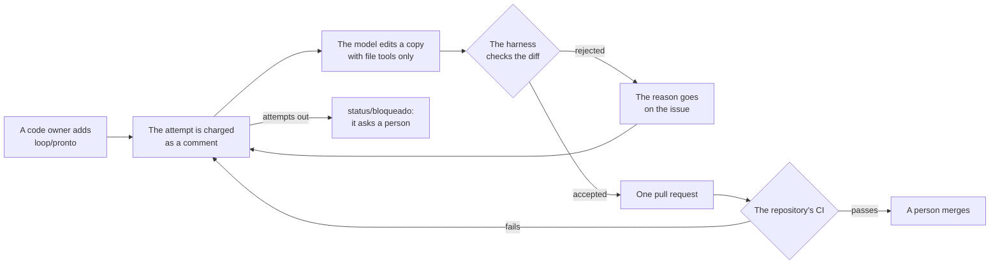

# agents

piabrota's buddies: small agents that watch [piabrota/nix-os](https://github.com/piabrota/nix-os)
and its VPS, and report on GitHub as the App **piabrota-ops**. Each is a bash script that gathers
its inputs into a directory and asks [Claude Code](https://code.claude.com) headless, with
read-only tools, what they mean. They run on the VPS as [rax](https://github.com/piabrota/rax)
tasks, one pod per run (rax's pod runner), on a Claude subscription rather than an API key.

| Agent | Runs | Reads | Writes |
|---|---|---|---|
| `deploy-doctor` | in `tick` | failed runs of nix-os' `deploy` workflow in the last day without an issue: the failed jobs' logs (last 400 lines, colour codes stripped) and the repository at that commit | one issue per failed run, labelled `deploy-failure`: verdict, what failed, why, the evidence, what to do; a short comment on the merged pull request the deploy came from; and, when the verdict is `real`, **a fix pull request** against the branch that failed |
| `pr-reviewer` | in `tick` | each open pull request whose head it has not reviewed: its diff, commits, body, and the repository at its head | one review comment, edited on each push: the rules the harness checks itself, and Claude's findings, each quoting a line of the diff |
| `mentions` | in `tick` | comments naming `@piabrota-ops` in the last hour, from trusted people only | one reply each: an answer from the thread and the repository, with its evidence; or `try a fix` (a deploy-failure issue) and `review` (a pull request) as commands |
| `mirror-keeper` | in `tick` | open pull requests that change a doc but not its mirror (pt-BR and English) | a pull request into that pull request's branch that brings the mirrors up to date |
| `flake-annotator` | in `tick` | open pull requests labelled `flake-update` (nix-os' weekly workflow opens them with the closure difference) | one comment per head: the update's risk and what to watch after it deploys |
| `feedback` | in `tick` | the agents' issues labelled `report-wrong`, and their comments with a 👎 from a trusted person | lessons in memory, which each agent reads before it writes again |
| `gramatico-loop` | its own task, on [piabrota/gramatico](https://github.com/piabrota/gramatico), as the App **pirsig-2nd-brain** | one approved issue, or the failed checks of its own open pull request, and the repository | one pull request at a time, its repairs, and a comment that stops and asks a person when the attempts run out |
| `health-digest` | once a day | the box's health snapshot (the ConfigMap `ax-tasks/health-snapshot`, which the box writes), the last deploys, the previous digest and the last week's from memory | a comment on the open issue labelled `health-digest` (opened the first time) |

`agent tick` runs the agents that watch GitHub one after the other in one pod, every few minutes:
each exits in seconds when there is nothing new, without calling Claude, and one that fails does
not stop the rest. Every report ends with a small signature: the agent, the model and Claude Code's
version, the turns and time it took, and where it ran (user, pod, OS, kernel, CPUs, RAM, its
memory limit, the image).

## Memory and feedback

`lib/memory.sh` keeps what the agents did (diagnoses, reviews, digests, replies, fixes) and what
people said about it, in PGX on the box (`AGENTS_DB_URL`, the Secret `ax-tasks/agents-memory`; a
`file://` directory in the tests; without it, no memory). Two ways to say a report was wrong: the
label `report-wrong` on an issue the App opened, with a comment saying why, or a 👎 on a comment it
posted. `feedback` turns each into a lesson for the agent that wrote it, and that agent reads its
last lessons before it writes again. They are also the cases to check a prompt change against.

## Agents that write

`deploy-doctor`'s fixes and `mirror-keeper` push branches (`agents/...`) and open pull requests;
they never merge: a merge to nix-os' main is a deploy, and that stays a person's call. The harness
checks a diff before it pushes: at most 5 files and 200 lines for a fix, nothing under
`.github/workflows/` or `keys/`, not `flake.lock`, a key file or `system.stateVersion`, nothing
shaped like a credential; the mirror keeper may change only the mirrors. Pull requests are bipr
(pt-BR, then English) and carry no signature; the signature goes in a comment. They need Contents
read and write on the App; without it, these two do nothing and the rest work as before.

## The gramatico loop

`agent gramatico-loop` runs one step of a loop on piabrota/gramatico. Run it every 30 minutes as its
own rax task, not in `tick`: another repository, another App, and the only agent that starts work by
itself. Without `PIRSIG_APP_ID` and `PIRSIG_APP_PRIVATE_KEY_B64` it logs that it is off and exits 0,
so this can ship before the App exists.



Each step does one thing: it waits on the open pull request, repairs it, or starts the next issue.
The most urgent issue goes first (`prioridade/*`, then the lowest number).

**What can start work.** An open issue with `loop/pronto`, when the last person to add that label is
in `LOOP_APPROVERS` (default `h0ffmann robkler`, the repository's CODEOWNERS) and the issue's author is
trusted. The author matters because anyone can edit their own issue after the label. Only trusted
people's comments reach the model.

**What stops it.**

| Stop | Default | Ceiling | What happens |
|---|---|---|---|
| `LOOP_MAX_ATTEMPTS`, on one issue | 2 | 3 | The issue gets `status/bloqueado` and a comment. Adding `loop/pronto` again starts over |
| `LOOP_MAX_PER_DAY`, in the repository | 3 | 6 | Nothing more until the next day (UTC) |
| Open pull requests | 1 | 1 | The next issue waits for a person |
| `LOOP_MAX_FILES`, `LOOP_MAX_LINES`, per change | 8, 300 | 20, 800 | The change is not pushed |
| The label `loop/pare` on any open issue | | | The loop stops at once, without an error |
| A pull request of the loop closed by a person | | | The issue is not tried again until a new label |
| A person's commit on its branch | | | The loop leaves that pull request alone |
| No check ran on the commit | | | It is not a pass: the loop waits for a person |

A setting can tighten a limit, never remove it: a value above its ceiling fails the run before it
spends anything. Attempts are comments on GitHub, posted before the model runs, so a crash still
counts and no memory store can open the budget. The labels `loop/pronto` and `loop/pare` must exist in
gramatico: `ISSUE_LABELS.md` and `just labels` own them, so the loop does not create them.

**What it may change.** `rules/gramatico-protected.txt` lists the paths that stay with people: CI, the
quality gates, `AGENTS.md`, locks, dependency manifests, and what runs on a user's machine (the
plugin's binaries and hooks). The harness also rejects a deleted file, a symbolic link, a binary file,
fewer tests, fewer `⚠`, and a document without its mirror (`rules/gramatico-mirrors.txt`). A rejection
says why on the issue, and the next attempt reads it.

**Why the model never sees `.git`.** It has file tools, and a hook or a `core.fsmonitor` written into
`repo/.git` would run as code when the harness calls `git add`, in a pod that holds the App's key. So
the git directory lives outside the model's directory, and every git call names it.

**What it never does.** It never merges, never pushes outside `loop/issue-*`, and never arms
auto-merge: gramatico's `main` has no required review, so an armed pull request would merge with no
person. The App has no `workflows` or `administration` permission, so GitHub itself refuses a change
to a workflow.

### What came from ouroboric

[ouroboric-dev/ouroboric](https://github.com/ouroboric-dev/ouroboric) runs an agent factory. These
ideas came from it, adapted to a bash harness and one repository:

| Ouroboric | Here |
|---|---|
| Hard approval points that no config can switch off, and the budget cap as one of them (journal, "autonomy modes and hard gates") | The ceilings, checked at startup |
| "A flaky test re-runs the implementer all night" | Attempts charged before the model runs, per issue and per day |
| Loop: build, check, fix, with a checker that is not the agent grading itself (journal, "what harness, loop, graph mean") | The repository's CI decides; no run is a pass |
| Protected paths and the shrink guard (journal, "a definition of done for realms"; spec-driven development) | `rules/gramatico-protected.txt`, and the checks on tests and `⚠` |
| `ouroboric-pr-bot`: a manifest, no merge rights, a token for one named repository (`scripts/pr-bot.json`, `scripts/as-bot.sh`) | `apps/pirsig-2nd-brain.json`, and `lib/github-app.sh`, which already worked this way |
| Never arm auto-merge where no ruleset requires an approval (`AGENTS.md`, `scripts/pr-open.sh`) | No auto-merge at all, for now |
| Work from unapproved external sources is a hard approval point | A trusted author, and an approver's label |

Not taken: the graph engine, the sandboxed implementer that can run the build, and a separate
reviewer model. Here nothing can be built in the pod, so a wrong change only meets CI and a person.

## The image

`ghcr.io/piabrota/agents`, from `Dockerfile`: Debian slim, `curl`, `jq`, `openssl`, `git`, `psql` (for memory), and
Claude Code's standalone binary (2.1.316, its checksum pinned), as user 10001. About 525 MB, most
of it Claude Code. `.github/workflows/image.yml` publishes it on every push to `main` that changes
it; the run summary prints the digest that nix-os pins. A task's command picks the agent:

```console
agent deploy-doctor
agent health-digest
```

## What the agents need

Environment variables, which the VPS gives every task pod from the Secret `ax-tasks/agents`,
written from `/var/lib/kubesolo-secrets/agents.env` on the box (nix-os' `docs/KUBESOLO.md`,
"Agents"). One `KEY=VALUE` per line, no quotes, never in a repository:

| Key | What |
|---|---|
| `CLAUDE_CODE_OAUTH_TOKEN` | From `claude setup-token` on your machine: a year-long token for your Claude subscription. The agents' use counts against its limits |
| `GH_APP_ID` | piabrota-ops' App ID |
| `GH_APP_PRIVATE_KEY_B64` | Its private key, the `.pem` file in base64 on one line: `base64 -w0 piabrota-ops.*.pem` (on macOS, `base64 -i <file>`) |

Optional for the gramatico loop: `PIRSIG_APP_ID`, `PIRSIG_APP_PRIVATE_KEY_B64` (without them it is off), `LOOP_MODEL`, `LOOP_APPROVERS`, `LOOP_TIMEOUT` (`1200`) and the limits in "The gramatico loop".

Optional: `AGENTS_DB_URL` (memory; nix-os writes it as its own Secret), `REPO` (default
`piabrota/nix-os`), `TRUSTED_USERS` (`h0ffmann`; beyond the repository's owners, members and
collaborators), the models (`DEPLOY_DOCTOR_MODEL`, `PR_REVIEWER_MODEL`, `MENTIONS_MODEL`,
`MIRROR_KEEPER_MODEL`, `FLAKE_ANNOTATOR_MODEL`: `claude-sonnet-5-5`; `HEALTH_DIGEST_MODEL`:
`claude-haiku-5-5`), `FIX_PRS` (`1`), `TICK_AGENTS`, `LOOKBACK_HOURS` (`24`), `LOG_LINES` (`400`),
`HEALTH_SNAPSHOT_FILE` (a file instead of the ConfigMap).

## The GitHub App, pirsig-2nd-brain

Only the gramatico loop uses it, and it never shares piabrota-ops' key. A maintainer creates it once:

1. Create a GitHub App in the org's settings, with the name, permissions and no webhook of
   `apps/pirsig-2nd-brain.json`: Actions read, Contents read and write, Issues read and write, Pull
   requests read and write, Metadata read. No Workflows, no Administration.
2. Install it on `piabrota/gramatico` only.
3. Add to `agents.env` on the box: `PIRSIG_APP_ID`, and `PIRSIG_APP_PRIVATE_KEY_B64` (the `.pem` file in
   base64 on one line).
4. Add the labels `loop/pronto` and `loop/pare` to gramatico's `ISSUE_LABELS.md`, and run `just labels`.
5. Add a rax task in nix-os with the command `agent gramatico-loop`, every 30 minutes. Pin an image
   built after this change.
6. Before the first label, protect gramatico's `main` with a ruleset that requires a code owner's
   review. Nothing here depends on it, but the App's contents write has no other limit than this
   script.

## The GitHub App, piabrota-ops

The agents act on GitHub only as this App, never as a person, following marola-dev's MIP-0086 and
its `bot-token` action. What they post shows as `piabrota-ops[bot]`, and says nothing about the
tool that wrote it.

- Created in the org's settings (Settings, Developer settings, GitHub Apps), with no webhook.
  Repository permissions: Actions read, Contents read and write (for fix and mirror pull
  requests), Issues read and write, Pull requests read and write, Metadata read. Each agent asks
  for the most it can use and falls back to less: without Contents write there are no fix or
  mirror pull requests, without Pull requests write no comments on pull requests.
  Installed on `piabrota/nix-os` only.
- `lib/github-app.sh` mints each token from the App's key: for one named repository, with only
  the permissions that agent needs (`lib/common.sh`'s `mint_token` takes them from the most to the
  least), valid one hour. It refuses an empty repository or
  permission set, which GitHub would otherwise read as all of them.
- The key stays on the VPS. If a leak is suspected, revoke it in the App's settings, generate a
  new one, and replace `GH_APP_PRIVATE_KEY_B64` in `agents.env`.

## How strict the harness is

The rules that matter are enforced by the scripts and Claude Code's flags, not asked for in the
prompts:

1. **What Claude can do.** `--restricted` (no Bash or other code-running tool, no WebFetch, no
   settings files, the file tools confined to the agent's directory), `--tools` with read-only
   tools only (`Read,Grep,Glob` for the doctor, `Read` for the digest), `--strict-mcp-config` (no
   MCP servers), a pinned model ID (`claude-sonnet-5-5`, `claude-haiku-5-5`), a time limit.
2. **What it returns.** `--json-schema` with `prompts/<agent>.schema.json`: enums for the verdict
   and the status, required fields, lengths. Claude Code validates and retries; the harness renders
   the Markdown from the JSON, so the format cannot drift. `prompts/_rules.md`, the house rules,
   goes with every run (`--append-system-prompt`).
3. **What gets posted.** The doctor checks that every quoted line is in the file it names and that
   every file exists; a failing answer is retried once, told what failed, and after that the issue
   carries the facts the harness has (the failed steps, the log's last lines) and verdict
   `unclear`, without the model's text. Known transient failures (`rules/transient.txt`: SSH
   timeouts, cache errors, a lost runner) are matched before Claude runs and fix the verdict at
   `transient`. Anything shaped like a credential is scrubbed before posting. A digest that does
   not fit its schema twice is not posted; the run fails.

## Tests

```console
test/run.sh
```

Both agents against a fake GitHub API (`test/fake_github.py`, Python's standard library) and a fake
`claude` (`test/fake-claude`): the App's JWT and its signature, the token's repository and
permissions, which files Claude Code gets and with which flags, the issue and comment posted, one
issue per run, the digest issue reused. Needs bash, curl, jq, openssl, git and python3; no network,
no secrets. CI runs it with `shellcheck`. `.github/workflows/code-smell.yml` adds the strict
checks: `ruff` with every rule (`ruff.toml`) and radon's complexity (rank C fails) on the Python,
and `shfmt` on the bash.

## Licence

MPL-2.0.
